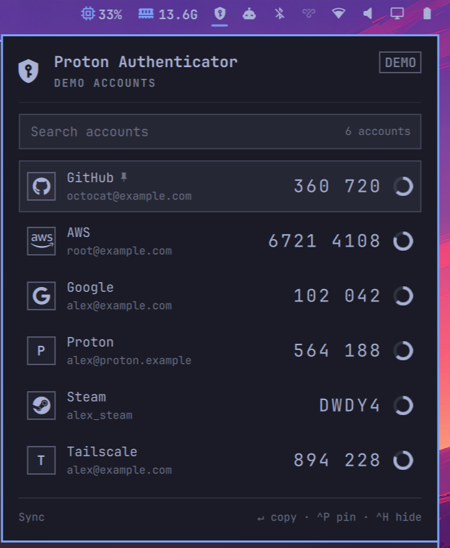
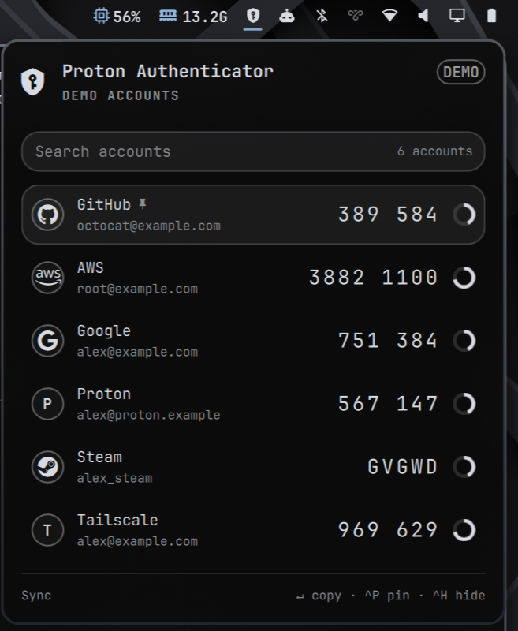

# Proton Authenticator for Omarchy

<p align="center">
  
  &nbsp;
  
</p>
<p align="center"><sub>Demo mode on the default Tokyo Night theme and on a dark custom theme. The panel follows the active Omarchy theme.</sub></p>

Your [Proton Authenticator](https://proton.me/authenticator) 2FA codes in a keyboard-driven
panel on the Omarchy bar: press a hotkey, type a few letters, press Enter, and the code is
on the clipboard. The plugin reads the official app's **local vault, read-only**; adding
accounts and syncing with Proton stay with the official app, and the plugin never touches
the network.

This is an independent implementation. Other Proton Authenticator plugins in the catalog
were not audited, and nothing here is a claim about them.

## Requirements

- Omarchy 4 (developed and tested on 4.0.6).
- The official app, `proton-authenticator` 1.1.x (AUR: `proton-authenticator-bin`), set
  up and synced at least once, with its key stored in the system keyring (the default).
- A Secret Service keyring. Omarchy ships `gnome-keyring`.
- Packages `install.sh` checks for, by Arch package name:

  | Package | Used for |
  | --- | --- |
  | `rustup` (then `rustup default stable`) or `rust` | building the helper (Rust 1.89 or newer) |
  | `libsecret` | `/usr/bin/secret-tool`, which reads the vault key from the keyring |
  | `glib2` | `/usr/bin/gdbus`, which asks the keyring whether it is locked |
  | `wl-clipboard` 2.3 or newer | `/usr/bin/wl-copy --sensitive` |

- A locked-memory limit (`ulimit -l`) of at least 8192 KiB, systemd's default. See
  [MEMLOCK_FAILED](docs/troubleshooting.md#memlock_failed).

## Install

The catalog lists this plugin as **Manual setup**: adding it only clones the repository,
and the helper has to be built once.

```bash
omarchy plugin add https://github.com/devSviat/omarchy-proton-authenticator
cd ~/.config/omarchy/plugins/sviat.proton-authenticator
./install.sh
omarchy plugin enable sviat.proton-authenticator
```

`install.sh` checks the dependencies above and builds the helper into `bin/pa-helper`. It
installs no packages, never uses `sudo`, refuses to run as root, piped or sourced, and its
only network access is cargo fetching the crates pinned by `Cargo.lock`.

### Updating

```bash
omarchy plugin update sviat.proton-authenticator
cd ~/.config/omarchy/plugins/sviat.proton-authenticator && ./install.sh
```

`omarchy plugin update` only pulls the repository, so re-run `install.sh` after every
update; until then the panel loads no codes and shows the command.

### Removing

```bash
omarchy plugin remove sviat.proton-authenticator
rm -rf ~/.cache/sviat.proton-authenticator ~/.local/state/sviat.proton-authenticator
```

The second line removes the build cache and the stored pins and settings.

## Usage

Click the bar icon, or bind a key. `Super + Alt + A` is a good fit; check that it is free
with `omarchy menu keybindings --print`, then add to `~/.config/hypr/bindings.lua`:

```lua
o.bind("SUPER + ALT + A", "Proton Authenticator", "omarchy-shell shell toggle sviat.proton-authenticator")
```

The panel opens with the search field focused. Search is fuzzy over issuer and account, so
`gh` finds GitHub.

| Key | Action |
| --- | --- |
| `Enter` | Copy the selected code (in privacy mode, a hidden row is revealed first) |
| `↑` `↓`, `Ctrl+J` `Ctrl+K` | Move the selection |
| `PgUp` `PgDn` | Move five rows |
| `Esc` | Clear the search; close the panel when it is already empty |
| `Ctrl+P` | Pin or unpin the selected account |
| `Ctrl+H` | Toggle privacy mode |
| `Tab`, `Shift+Tab` | Switch to the neighbouring bar panel |

- **Copying** closes the panel (`closeOnCopy`). With 5 seconds or less left, the next code
  is copied. The clipboard is cleared after 20 seconds unless you copied something else.
- **Order:** pinned, then the five most recently copied, then alphabetical. Recent order
  updates on the next open, so rows never move while you look at them.
- **Privacy mode** (`Ctrl+H`, remembered) hides every code until you choose its row with
  `↑` `↓`, `Enter` or a click. Hidden codes are not computed at all.
- **Sync** stays with the official app: the footer's **Sync** link opens its normal window
  (it has [no tray mode](docs/notes/proton-tray.md)), and new accounts appear once it has
  written them to the local vault.
- TOTP (SHA-1/256/512) and Steam codes are supported; others, such as HOTP, are listed as
  "unsupported". A [demo mode](docs/development.md#demo-mode) exists for screenshots.

## Settings

Set in the bar widget's settings or with `omarchy bar set`:

| Key | Default | Meaning |
| --- | --- | --- |
| `clearClipboardSeconds` | `20` | Clear the copied code after this many seconds (5–120) |
| `closeOnCopy` | `true` | Close the panel after copying |
| `staleHours` | `24` | Show the "Not synced" hint after this many hours without a vault change (1–168) |

## Security

- TOTP seeds and decrypted items exist only inside `pa-helper`, a short-lived, hardened
  process (non-dumpable, memory locked); the panel receives only ids, labels and codes.
- The vault is read-only to the plugin; the helper reads it with its own parser, without
  SQLite. The helper has no network code.
- Codes go to `wl-copy --sensitive`, held by a detached process that clears the clipboard
  after the timeout if it still holds the code.
- Privacy mode decrypts at most one entry per request.

The full threat model, including what the plugin does not protect against, is in
[docs/security.md](docs/security.md). To report a vulnerability, see [SECURITY.md](SECURITY.md).

See also [Troubleshooting](docs/troubleshooting.md) and [Development](docs/development.md).

## License

MIT, see [LICENSE](LICENSE).

This project is not affiliated with, endorsed by, or supported by Proton AG. Proton and
Proton Authenticator are trademarks of Proton AG; other names and brand glyphs belong to
their respective owners.
